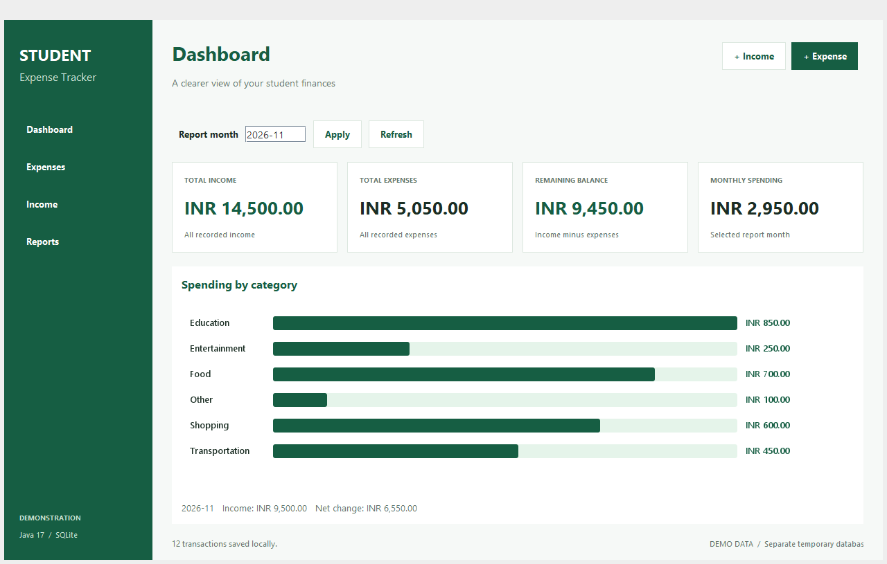
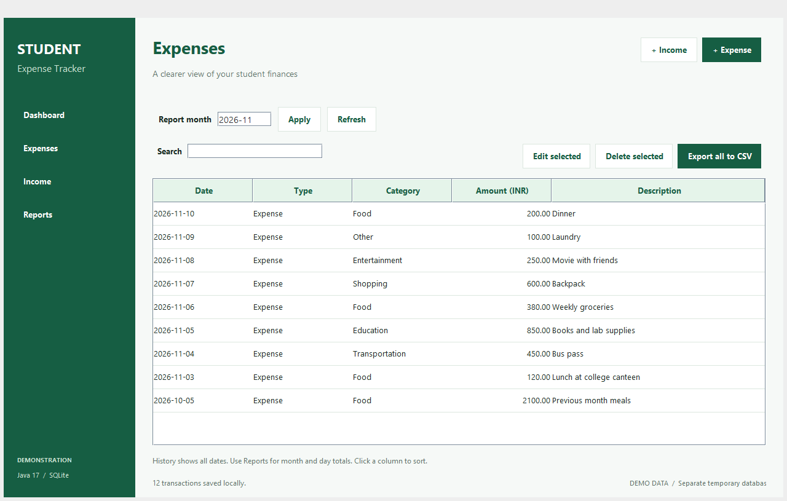
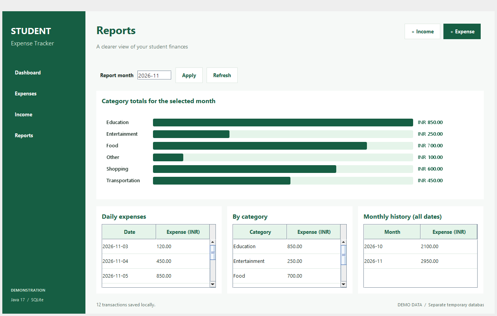

# Student Expense Tracker

A clean Java 17 desktop application that helps college students record income, understand expenses, and review monthly spending. Built with Swing, SQLite, JDBC and Maven.



## Features

- Dashboard with total income, total expenses, remaining balance and selected-month spending.
- Add, edit and delete income or expenses, with confirmation before deletion.
- Expense categories: Food, Transportation, Education, Shopping, Entertainment and Other.
- Income sources: Pocket Money, Scholarship, Part-time Work, Gift and Other.
- Date, optional description, sortable history and text search.
- Daily and category reports for a selected month, plus expense history across months.
- A simple category bar chart and tables with exact values.
- Persistent SQLite data and UTF-8 CSV export of **all** transactions.
- Separate demo mode with synthetic records. It never seeds your personal database.

## Technology

| Component | Technology |
| --- | --- |
| Language | Java 17 |
| Desktop interface | Java Swing and Java2D |
| Storage | SQLite through Xerial sqlite-jdbc 3.46.1.0 |
| Database access | JDBC prepared statements |
| Build and packaging | Maven, Shade plugin |
| Tests | JUnit Jupiter 5.11.0 |
| Version control | Git |

The application has no web server and requires no online account. Internet access is needed for the first Maven build to download dependencies. The packaged application runs offline.

## Run on Windows

1. Install a **Java 17 JDK**, such as Eclipse Temurin or Azul Zulu, and Apache Maven 3.9 or newer. Add their `bin` directories to PATH.
2. Extract the source ZIP or clone the published repository, then open PowerShell in the project folder.
3. Confirm the tools and build:

```powershell
java -version
mvn -version
mvn clean verify
java -jar target/student-expense-tracker.jar
```

You can also double-click `run-windows.bat`. If a packaged JAR already exists, Maven is not needed to launch it. The separate runnable download needs Java 17 or newer, but does not bundle a JRE.

Demo mode:

```powershell
java -jar target/student-expense-tracker.jar --demo
```

The complete submission ZIP contains the runnable JAR at its top level. From that folder, run `java -jar student-expense-tracker.jar`, or double-click `Run-Application.bat`.

## Data location and backup

By default, data lives at `%USERPROFILE%\.student-expense-tracker\expenses.db`, independently of the installation folder. The application creates the directory, table and date index automatically. Closing and reopening the program uses the same file. Moving the JAR does not move this database.

To select another database, put the Java property **before** `-jar`:

```powershell
java "-Dexpense.tracker.db=C:\MyData\student-finances.db" -jar target/student-expense-tracker.jar
```

Close the application and copy `expenses.db` to a safe location to back up all records. CSV export is useful for sharing and spreadsheet analysis, but this version does not import CSV. Demo mode creates a new temporary database on every launch. Demo files may remain in the operating system's temporary directory.

## Sample usage

1. Click **+ Income**, enter `5000`, select **Pocket Money**, enter today's date and save.
2. Click **+ Expense**, enter `120.50`, select **Food**, add a description and save.
3. The dashboard now shows income `INR 5,000.00`, expenses `INR 120.50` and balance `INR 4,879.50` for this example in an otherwise empty database.
4. Open **Expenses**, select a row and use **Edit selected** or **Delete selected**.
5. Enter the report month as `YYYY-MM` and click **Apply**. Open **Reports** for daily totals, category totals and monthly history.
6. Use **Export all to CSV** on Income or Expenses. Choose a filename and confirm if replacing an existing file.
7. Restart the application and confirm the records are still present.

History pages show all dates. Their search filters the visible table. CSV exports all income and expenses, regardless of the current page, search or report month. Future dates are allowed. The balance represents all recorded entries, including any future-dated entries, and is not a bank account balance. A negative balance is allowed. Estimated savings are represented by the remaining balance, rather than a separate savings-goal feature.

## Architecture and project structure

```text
src/main/java/com/studentfinance/
  App.java                 Application entry point
  model/                   Transaction, type and supported categories
  database/                SQLite path, connection and initialization
  dao/                     Repository interface and JDBC implementation
  service/                 CRUD coordination and financial summaries
  ui/                      Swing window, forms, tables, theme and chart
  util/                    Money conversion, CSV export and demo data
src/test/java/             Integration tests, restart probe and UI capture
docs/                     Design, authentication, tests and demonstration guide
```

Swing actions call the service. The service depends on the `TransactionDao` interface. Its SQLite implementation uses short-lived connections and parameterized SQL. Database and file operations run in a SwingWorker, so normal operations do not block the Swing event thread. Monthly aggregation uses an in-memory snapshot, suitable for this small project.

## Authentication and credentials

This is a **single-user local application with no login system**. It has no passwords, JWTs, OAuth tokens, sessions, API keys or network authentication requests. SQLite opens a file with `DriverManager.getConnection("jdbc:sqlite:" + path)` and does not require database credentials. The operating system account and file permissions control access to that file. The database and CSV files are not encrypted.

See [authentication and request flow](docs/AUTHENTICATION.md), [architecture](docs/ARCHITECTURE.md) and [Java concepts](docs/MENTOR_GUIDE.md). GitHub connection credentials used to publish source are external to the program and must never be put in its source, database, screenshots or ZIP.

## Correctness and validation

- Amounts use integer paise. `BigDecimal` converts typed amounts without silent rounding.
- Each entry must be between `INR 0.01` and `INR 10,00,000.00`, with at most two decimal places.
- Categories must match the selected type. Dates use strict ISO calendar parsing. Descriptions allow up to 250 characters.
- SQLite CHECK constraints enforce type, amount and category rules. The model validates actual dates.
- Prepared statements treat quotes and SQL-looking descriptions as data.
- CSV escaping supports commas, quotes and newlines. Leading formula characters receive an apostrophe for spreadsheet safety.
- Export writes a temporary file before replacing its destination.

## Tests and evidence

Run `mvn clean verify`. The verified build ran **20 integration tests with zero failures, zero errors and zero skipped tests**. A separate test wrote a record, exited the JVM, and read the same record in a new JVM. See [testing details](docs/TESTING.md) for the distinction between automated checks and manual demonstration checks. Raw JUnit XML and text evidence are included in the submission package.

The screenshots below come from the actual rendered Swing application and show **synthetic demo data**.




## Limits and future work

The app supports one local user and INR only. It does not provide cloud synchronization, encryption, authentication, bank connections, recurring transactions, CSV import, budgets or savings goals. All records load into memory, which keeps the design approachable but is unsuitable for very large datasets. Possible extensions include budgets, encrypted backups, recurring entries and CSV import.

## College submission

The submission package includes a PDF report, a 12-slide PowerPoint deck, a runnable JAR, source, test evidence, a demonstration script and 20 viva questions. Fill the report's student and institution placeholders before submission. The certificate page is an unsigned template, not an institutional approval.

A desktop Swing app has no hosted web URL. Share a short screen recording instead. See [submission and sharing instructions](docs/SUBMISSION_GUIDE.md).

## References

- [Java 17 Swing API](https://docs.oracle.com/en/java/javase/17/docs/api/java.desktop/javax/swing/package-summary.html)
- [Oracle JDBC basics](https://docs.oracle.com/javase/tutorial/jdbc/basics/)
- [SQLite documentation](https://www.sqlite.org/docs.html)
- [Xerial SQLite JDBC](https://github.com/xerial/sqlite-jdbc)
- [Apache Maven](https://maven.apache.org/guides/getting-started/)

## License

MIT. See [LICENSE](LICENSE). Dependency licenses remain with their respective projects.
