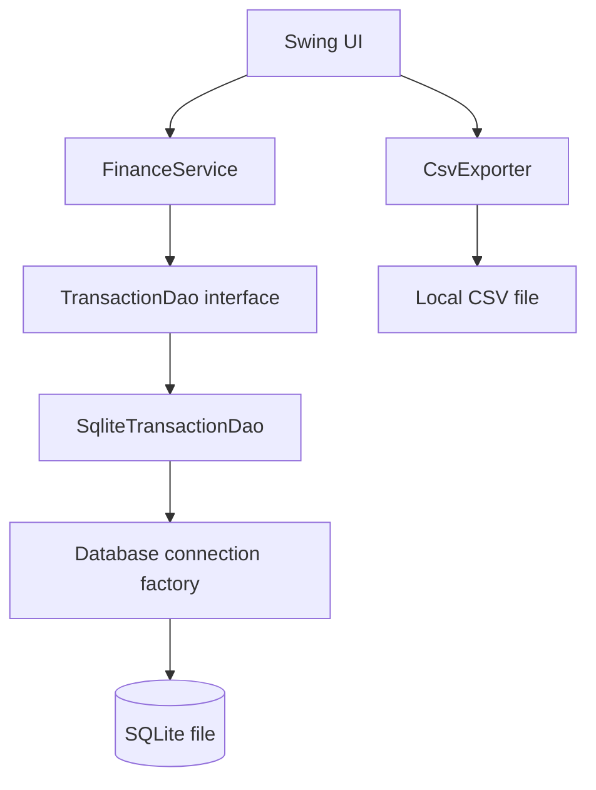

# Architecture and database design

The UI handles presentation and input. The service provides finance operations. The DAO interface separates those operations from SQLite. This small layered design keeps the application suitable for a second-year Java project.

## Database table

| Column | SQLite type | Meaning |
| --- | --- | --- |
| id | INTEGER PRIMARY KEY AUTOINCREMENT | Unique record identity |
| type | TEXT NOT NULL | INCOME or EXPENSE |
| amount_paise | INTEGER NOT NULL | Positive amount in paise, from 1 to 100000000 |
| category | TEXT NOT NULL | Category allowed for the selected type |
| transaction_date | TEXT NOT NULL | ISO date, YYYY-MM-DD |
| description | TEXT NOT NULL | Optional description, maximum 250 characters |

The index `idx_transactions_date` supports queries ordered by transaction_date. Income and expenses share one table because their fields are the same. Type distinguishes their financial effect. Categories are fixed constants, avoiding extra CRUD screens for this scope. There is no user table or foreign key because there is one local user. SQLite supports flexible typing, so explicit CHECK constraints also validate the stored amount's integer storage class. Actual date validity is checked by Java LocalDate.

## Summary rules

- Total income = sum of all income amounts.
- Total expenses = sum of all expense amounts.
- Remaining balance = total income minus total expenses.
- Monthly totals = entries whose YearMonth matches the selected report month.
- Daily expenses and category totals = expenses in that selected month, grouped by date or category.
- Monthly history = all expenses grouped by YearMonth, including different years.

All amounts use long paise with overflow checks. Money converts decimal strings through BigDecimal. `INR 120.50` is stored as `12050`.

## Concurrency and persistence

The Swing event dispatch thread creates and updates components. SwingWorker executes JDBC CRUD, reload and CSV tasks in a background thread. The window allows one such operation at a time. It publishes an immutable list snapshot to the UI after success. Each DAO call owns its JDBC connection, statements and result sets. SQLite busy_timeout permits a short wait for a lock. Each individual write is an auto-committed SQLite statement.

Summary calculation and table filtering are in memory on the UI thread. This is suitable for a small student dataset. A larger product would use pagination and database aggregation. The database path is independent of the working directory and is reused at restart. Demo mode uses a separate temporary path and never modifies the normal database.
