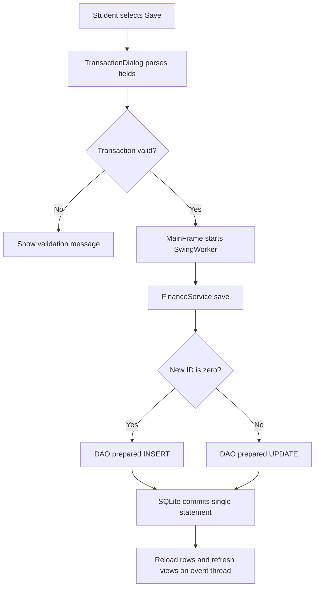

# Authentication, components and request flow

## Scope

The starting workspace had no existing repository or application to audit. This document describes the Student Expense Tracker implemented here, based on its code. It is an offline, single-user Java desktop application. There is deliberately no application authentication feature because login and multiple accounts are outside the requested feature set.

## Components and responsibilities

| Component | Code | Responsibility |
| --- | --- | --- |
| Startup | `App.main` | Choose a personal or isolated demo database, initialize it, create the service and launch Swing |
| Input form | `TransactionDialog` | Read fields and construct a validated immutable Transaction |
| Window/controller | `MainFrame` | Handle actions, run database/file work in SwingWorker, refresh views |
| Business layer | `FinanceService` | Coordinate save/delete/read and calculate summaries |
| Persistence abstraction | `TransactionDao` | Define storage operations without exposing SQL to the UI |
| Persistence implementation | `SqliteTransactionDao` | Execute prepared JDBC statements and map rows to objects |
| Database connection | `Database.connect` | Open a local SQLite file and set connection pragmas |
| Export | `CsvExporter` | Write UTF-8 CSV with quoting and spreadsheet formula protection |

## Startup flow

`App.main` chooses `Database.defaultPath()` or a temporary file when `--demo` is present. `Database.initialize()` creates the parent directory, the `transactions` table and a date index if needed. The DAO receives the Database object, FinanceService receives the DAO interface, and MainFrame receives the service. `SwingUtilities.invokeLater` starts the UI on the Swing event thread.

## Save request flow



These are local method calls, rather than HTTP requests. New objects use ID 0 until SQLite assigns their ID. Statements and connections close through try-with-resources. Each write uses JDBC auto-commit for that single statement. Delete follows the same layers after a user confirmation. Missing IDs raise an error instead of claiming success.

## Credentials and tokens

The complete database connection call is:

```java
Connection connection = DriverManager.getConnection("jdbc:sqlite:" + path);
```

There is no username/password argument, Authorization header, credential store or token refresh flow. No user password, JWT, OAuth access token, refresh token, API key or session cookie is generated, accepted, persisted or logged by the application. The `expense.tracker.db` system property is only a file location, not a secret.

GitHub authentication belongs to the connected publishing tool or the user's own Git client. It is separate from the desktop application's runtime. No GitHub token is required to build or use this application and none should be committed or packaged. This project does not implement or inspect the connector's internal token storage.

## Actual security boundary

Anyone with filesystem access to the database can read or change the records. SQLite storage and exported CSV files are unencrypted. OS user separation, file permissions and careful backup handling provide the current boundary. This version has no per-user authorization or network service to protect. Adding a login screen alone would not encrypt or protect a copied database file.

Prepared statements protect SQL parameter values. Validation limits invalid amounts, categories, dates and text length. CSV formula neutralization reduces the risk from spreadsheet interpretation. These are data handling protections, not authentication mechanisms. The tests in `FinanceIntegrationTest` verify SQL-looking descriptions remain data, CHECK constraints reject invalid writes and formula-leading CSV descriptions receive protection.

## Review points

- Startup and path selection: `src/main/java/com/studentfinance/App.java`
- Credentials-free JDBC connection: `database/Database.java`
- Parameter binding and resource closure: `dao/SqliteTransactionDao.java`
- Model invariants: `model/Transaction.java`
- Background request coordination: `ui/MainFrame.java`
- CSV handling: `util/CsvExporter.java`

All abbreviated paths in this list are beneath `src/main/java/com/studentfinance/`.
